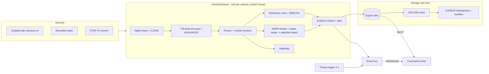

# IBVAP: Intelligent Border Video Analytics Platform

**AI analytics for the CCTV a border post already has.** IBVAP turns ordinary IP / RTSP cameras into a monitored, evidence-grade surveillance network: it detects and tracks people and vehicles, reads number plates, recognises intrusion and suspicious behaviour, scores the threat per sector, runs an incident workflow, and makes every record tamper-evident with a hash chain plus Ed25519 signatures.

Team **KavachX**. CodeQuest: National Tech Hackathon 2026, Final Build & Innovation Showcase.

> **Live demo:** [ibvap-e0nn.onrender.com](https://ibvap-e0nn.onrender.com/) &nbsp;|&nbsp; **Demo video:** [youtu.be/ygBbFJ7840Q](https://youtu.be/ygBbFJ7840Q)
>
> The live demo runs on Render's free plan: it sleeps after 15 minutes idle, so the first visit takes about a minute to wake.

---

## What is new in the final round (v3)

| Area | Round 2 MVP | Final build (v3) |
|---|---|---|
| Cameras | One simulated feed at a time | **4-camera site** (fence, ANPR check post, river crossing, perimeter road) running concurrently; one pipeline per camera shared by every viewer |
| Situational awareness | Alert list | **Per-sector and site threat level** (decaying, severity-weighted), live command center, camera wall |
| Vehicles | Plate read logged as text | **Indian-format plate repair, OCR-tolerant watchlist matching** (exact / look-alike / one-character), **cross-camera trajectory** on a site map |
| Incidents | Acknowledge only | **Full workflow** (acknowledge, investigate, escalate, resolve, false positive), notes, owner, bulk actions, **hash-chained chain of custody** |
| Evidence | SHA-256 chain + hashed frame | + **Ed25519-signed checkpoints** (catch a full-chain forgery that fools a plain hash chain) + **signed evidence bundles** verifiable offline |
| Real footage | Per-session YOLO load, ~420 ms/frame on 8 MP clips | **One shared YOLOv8 pass for people + vehicles**, resolution-aware thresholds, async ANPR worker: **~70-160 ms/frame** |
| Analytics | KPI tiles | Severity timeline, by type / camera / status, live occupancy, movement heatmap, printable **shift briefing** |
| Operations | Manual setup | Guided demo tour, zone calibration UI (persisted), system health, Docker image, 27 automated tests |

## Features

- **Detection and tracking**: YOLOv8n (people, car, truck, bus, motorcycle, bicycle) in one pass, with an offline HOG + MOG2 floor that needs no GPU and no downloads. Hungarian-assignment centroid trackers keep stable IDs.
- **Behaviour analytics**: direction-aware virtual-fence crossing, loitering by dwell time, group and convoy formation (DBSCAN), erratic motion (smoothed speed), night-time movement with LAB brightness detection and CLAHE enhancement. Every pixel threshold scales with the camera resolution.
- **ANPR**: plate localisation (Haar cascade + contour geometry), multi-pass Tesseract (plus EasyOCR when its models are present), positional repair (state code letters, last four digits), Indian HSRP and BH-series validation, running on a background worker so OCR never stalls video.
- **Watchlist**: OCR-tolerant matching folds look-alike characters (0/O/D, 1/I/L, 8/B, 5/S, 2/Z, 6/G) and allows one residual error on full-length plates. Each hit says which rule matched.
- **Threat scoring**: `score = 100 * (1 - exp(-sum(weight * exp(-age/75s)) / 70))` per camera. Resolving an incident removes it from the score.
- **Incident workflow** with operator attribution; every action is a chained audit record.
- **Tamper evidence**, three independent layers:
  1. SHA-256 hash chain over every alert, event, action and watchlist change.
  2. Row snapshots: each visible row is compared with its chained copy.
  3. Ed25519-signed checkpoints of the chain head, with the key outside the database.
- **Signed evidence bundles**: a ZIP of alert, custody trail, audit record, evidence frame, public key, a SHA-256 manifest and its signature. It can be verified in the dashboard or offline with ten lines of Python.
- **Chain integrity report**: a printable report (Evidence & Audit, then Integrity report) giving the verdict of each layer, the exact broken link, a field-by-field diff of every altered row against its chained original, and every signed checkpoint. Its verdict summary is itself Ed25519-signed.
- **Command-center UI**: no build step, works offline, dark and light themes, phone-width layout, live WebSockets, guided demo.

## Architecture



| Layer | Technology |
|---|---|
| API and realtime | Python 3.11+, FastAPI, Uvicorn, WebSockets, raw ASGI API-key middleware |
| Vision | OpenCV 4.13, Ultralytics YOLOv8n, NumPy, SciPy (Hungarian), scikit-learn (DBSCAN) |
| OCR | Tesseract 5 via pytesseract, optional EasyOCR |
| Storage and trust | SQLite (WAL, single-writer queue), SHA-256, Ed25519 (`cryptography`) |
| Frontend | HTML, CSS, vanilla ES modules, hand-built SVG charts (no CDN, no build) |
| Delivery | Docker, Windows one-click scripts, pytest |

## Run it

**Windows (one click)**

```powershell
setup.bat      # once: venv, dependencies, YOLOv8, OpenCV fix
run.bat        # starts the server and opens http://localhost:8000
```

**Linux / macOS**

```bash
./run_local.sh                    # http://localhost:8000
```

**Docker**

```bash
docker compose up --build         # http://localhost:8000
```

**Render (free hosting)**

1. On [render.com](https://render.com), choose **New > Blueprint** and connect this repository. `render.yaml` creates one Docker web service.
2. Wait for the first build (about 5 minutes), then open the `.onrender.com` URL. The dashboard and API share that one URL.

The free plan has 512 MB of RAM and 0.1 CPU, so `render.yaml` runs a light profile:
- the offline HOG + MOG2 detector instead of YOLOv8
- one OpenCV thread
- people detection at 480 px on every third frame
- two Tesseract calls per vehicle instead of up to thirty

Measured with these settings (from CPU time per frame), expect about **2 fps for a live simulated camera** and **0.4 to 1.2 fps for the sample clips**, with memory around 370 MB. Every feature works, just slowly. A paid instance (Starter, 0.5 CPU) is about 5 times faster; for full speed and YOLOv8, run IBVAP locally.

Free services sleep after 15 minutes idle and take about a minute to wake, and the database resets on restart. Open the link a minute before judging.

For ANPR on real footage install the Tesseract binary ([Windows installer](https://github.com/UB-Mannheim/tesseract/wiki), `apt install tesseract-ocr`, or `brew install tesseract`). Everything else runs without it.

Open the dashboard and press **Guided demo** for a 10-step tour. Four demo clips ship in `samples/` and appear under **Video Sources**; drop your own MP4s there to analyse them too.

| Setting (env var) | Default | Meaning |
|---|---|---|
| `IBVAP_API_KEY` | `ibvap-demo-key-2026-CHANGE-ME` | Key for every `/api` route. Change it before any public deployment; the dashboard then asks for it. |
| `IBVAP_DETECTOR` | `auto` | `auto` uses YOLOv8 when installed, `hog` forces the offline floor |
| `IBVAP_DATA_DIR` | `./data` | Database, evidence frames, signing key |
| `IBVAP_CHECKPOINT_EVERY` | `25` | Audit records between signed checkpoints |

## Tests

```bash
cd backend
python -m pytest -q        # 27 tests, ~40 s, isolated temp database
```

The tests cover API-key enforcement, live streaming, the watchlist hit on the check-post camera, the full incident workflow, evidence frames and reports, a signed-bundle round trip plus edited-file and raw-byte-flip tampering, all three tamper attacks (including the full-chain forgery only the signature catches), reset, watchlist CRUD and fuzzy matching, zone persistence, the threat engine, plate repair, and that every alert type fires across the four scenarios.

## API

55 endpoints (50 REST, 5 WebSocket), with interactive docs at `/docs`. Main groups:

- `WS /api/ws/stream/{id}`: annotated frames, tracks and alerts. `WS /api/ws/events`: every alert plus threat and stream health.
- `/api/alerts`: query, detail, workflow `action`, `bulk`, `snapshot`, `report`, `evidence`. `POST /api/evidence/verify` checks a bundle.
- `/api/intel/plates`, `/trajectory`, `/watchlist`, `/match`.
- `/api/analytics/summary`, `timeline`, `threat`, `occupancy`. `/api/reports/shift` is the printable briefing.
- `/api/audit/verify`, `report` (printable integrity report), `records`, `checkpoints`, `public-key`, `demo/seed|attack1|attack2|attack3`.
- `/api/replay/sample|start`, `/api/live/rtsp/connect`, `/api/zones/{camera}`, `/api/system/status`.

## Repository layout

```
backend/app/
  main.py            app, API-key middleware, lifespan, threat broadcaster
  config.py          paths and settings
  api/               streams, incidents, intel, audit, analytics routers
  core/
    pipeline.py      CameraSession: the per-camera pipeline and overlays
    streams.py       stream workers (sim / video / RTSP) and the site cameras
    simulator.py     four scripted border scenarios
    detector.py      shared YOLOv8 pass, HOG floor
    vehicle.py       MOG2 vehicle floor
    tracker.py       Hungarian centroid tracker
    analytics.py     behaviour rules
    anpr.py          plate localisation, OCR, async worker
    plates.py        repair, validation, OCR-tolerant matching
    threat.py        threat scoring
    storage.py       SQLite, hash chain, checkpoints, workflow, tamper demo
    crypto.py        Ed25519 key
    evidence.py      signed bundles
    hub.py           event bus
backend/tests/       27 pytest tests
frontend/            index.html + static/css + static/js (no build)
samples/             four 960px demo clips for Video Sources
render.yaml          one-click Render deployment (Docker, free plan)
```

## Honest limitations

- The four "site cameras" are **scripted scenarios** feeding the real tracker, analytics, ANPR matching and evidence chain. They are labelled SIMULATED on screen. Real detection runs on recorded video and RTSP.
- RTSP connection, timeout and reconnect logic is implemented, but we have not tested it against a physical IP camera.
- ANPR quality on real CCTV depends on plate resolution and angle. Our sample clips are not Indian roads, so plate reads there are rare; plate logic is validated on Indian formats in tests.
- Face detection is localisation only (Haar). There is no identity recognition, which needs a legal framework for enrolment.
- The signing key lives on the server's disk. Production should keep it in an HSM or a separate signing service.
- Cross-camera matching is by plate. Appearance re-identification is an HSV heuristic, not a learned embedding.

## Licence and credits

Code by Team KavachX for CodeQuest 2026. YOLOv8 weights are © Ultralytics (AGPL-3.0). The clips in `samples/` are reduced copies of third-party stock footage, included only for the demo.
